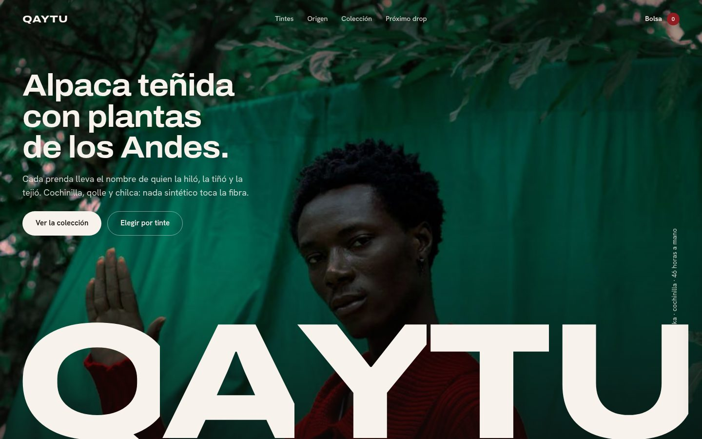
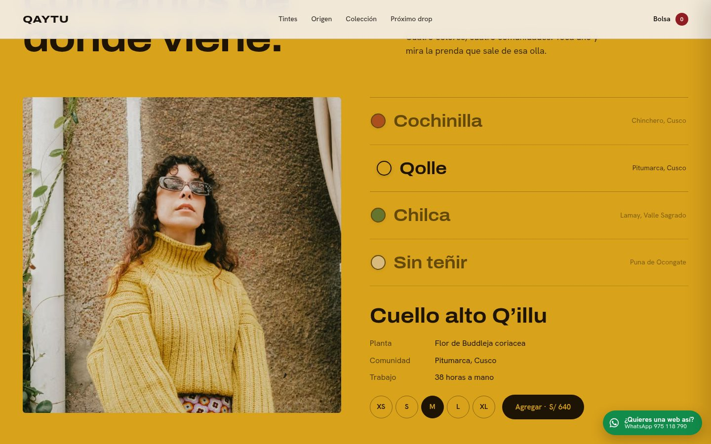
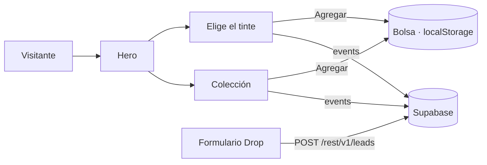
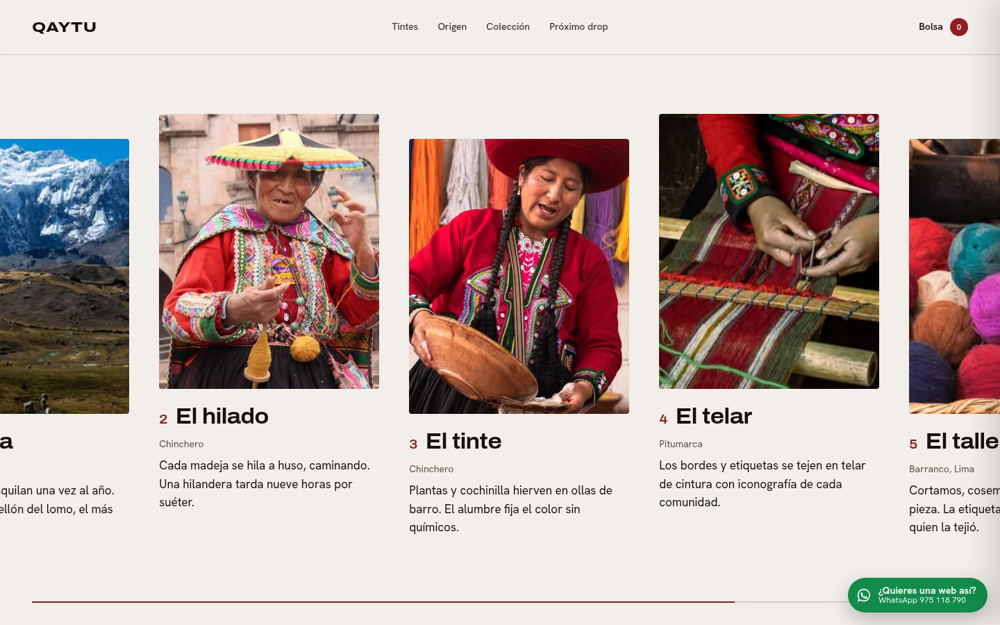
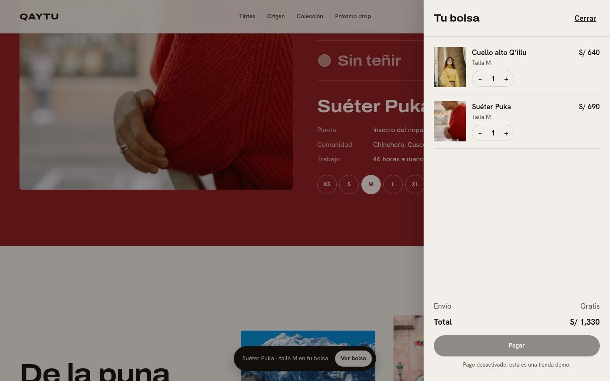

# QAYTU — tienda de moda andina con trazabilidad

**Demo en vivo:** https://landing-fashion-store-danielyatacoblas-projects.vercel.app



## El problema

Las marcas de alpaca venden "artesanal" y "natural", pero el cliente nunca ve de dónde sale su prenda. Sin prueba, el precio alto parece caro en vez de justo, y la tienda compite solo por descuento.

QAYTU es una marca ficticia que resuelve eso con diseño: **cada prenda muestra su tinte, su planta, su comunidad y las horas de trabajo**. La landing convierte esa historia en algo que el visitante toca, no solo lee.

## Qué hace

| Sección | Qué resuelve | Técnica |
|---|---|---|
| Hero | Entender la oferta en un vistazo | Revelado con `clip-path`, letras con GSAP timeline, parallax con ScrollTrigger |
| Elige el tinte | Ver de dónde viene cada color | La sección entera se tiñe del color elegido (variables CSS animadas con GSAP), radiogroup accesible con flechas |
| De la puna a tu ropero | Contar el proceso en 5 paradas | Scroll horizontal anclado (`pin` + `containerAnimation`), parallax interno por foto, lista vertical en móvil |
| Colección | Comprar | Filtros por línea, agregado rápido, grilla editorial que se completa sola |
| Manifiesto | Justificar el tiempo de trabajo | Texto que se "entinta" palabra por palabra con el scroll |
| Drop | Captar leads | Formulario con validación, estados de envío/error/éxito, guardado en Supabase |
| Bolsa | Carrito real | Drawer con foco atrapado, Escape, cantidades, envío gratis desde S/ 600, persistencia en `localStorage` |



## Stack

- **Next.js 16** (App Router, prerender estático) + **React 19** + **TypeScript** estricto
- **GSAP 3 + ScrollTrigger** para la coreografía de scroll y **Lenis** para scroll suave, sincronizados en el mismo reloj
- `next/font` (Archivo ancho + Hanken Grotesk) y `next/image` (AVIF/WebP, `priority` en el hero)
- **Supabase** REST opcional para leads y eventos
- Desplegado en **Vercel**





## Diseño

- Construido con las skills de [Impeccable](https://impeccable.style/) y [Emil Kowalski](https://github.com/emilkowalski/skills): curva `cubic-bezier(0.23, 1, 0.32, 1)`, transiciones de UI bajo 300 ms, `scale(0.97)` al presionar, hover solo en dispositivos con puntero fino.
- `prefers-reduced-motion`: se apagan Lenis y todas las animaciones; el recorrido horizontal pasa a scroll nativo.
- Accesibilidad: skip link, foco visible con el color de marca, contraste AA, `aria-live` en la bolsa y el formulario.
- Detalles de navegador tematizados: selección, cursor de texto, scrollbar, números tabulares en precios.



## Correr local

```bash
npm install
npm run dev        # http://localhost:3000
npm run build      # build de producción
```

Para guardar leads reales, crea las tablas del bloque SQL de abajo y define en Vercel:

```
NEXT_PUBLIC_SUPABASE_URL=https://xxxx.supabase.co
NEXT_PUBLIC_SUPABASE_ANON=eyJ...
```

```sql
create table leads  (id bigint generated always as identity primary key, email text not null, source text, created_at timestamptz default now());
create table events (id bigint generated always as identity primary key, name text not null, data jsonb, created_at timestamptz default now());
alter table leads enable row level security;
alter table events enable row level security;
create policy "insert anon" on leads  for insert to anon with check (true);
create policy "insert anon" on events for insert to anon with check (true);
```

Sin estas variables la tienda funciona igual: el formulario confirma en local.

## Créditos

- Fotografía: [Pexels](https://www.pexels.com) (licencia libre de uso comercial).
- Marca, prendas, precios y comunidades asignadas son **ficticios**, de ejemplo: es un diseño demo. El pago está desactivado.

## Contacto

¿Quieres una web así para tu negocio? Escríbeme por WhatsApp al **[975 118 790](https://wa.me/51975118790)**.

---

Diseñado y desarrollado por [Daniel Yataco](https://github.com/danielyatacoblas).
